# MeetingNote Pro

로그인한 팀이 함께 쓰는 회의록 서비스입니다. 녹취 파일을 올리면 받아쓰기를 거쳐 **요약 · 결정사항 · 할 일** 세 항목으로 나뉘고, 할 일은 **칸반**으로 추적되며, **댓글**과 **활동 기록**이 팀의 맥락을 남깁니다.

> 기초편 MeetingNote 의 확장 항목(JWT 로그인 · 팀 공유)을 심화편에서 구현한 프로젝트입니다. 스펙(OpenSpec) → 구현 → 테스트 순서로 진행했고, 화면은 확정된 퍼블리싱(`publish/`)의 색과 클래스 규칙을 그대로 따릅니다.

| | |
|---|---|
| 백엔드 | FastAPI · SQLAlchemy · SQLite(로컬) / Postgres(`DATABASE_URL` 이 있으면) |
| 프론트 | Vanilla JS · Tailwind CDN · 화면 6종 |
| 인증 | JWT(24시간) + bcrypt 해시 |
| 받아쓰기 | Gemini (오디오 → 전문 → 요약·결정사항·할 일 구분) |
| 테스트 | pytest 90개 + Playwright 화면 시험 |
| 배포 | Vercel + Neon Postgres — https://meetingnote-pro-blush.vercel.app |

---

## 1. 화면 둘러보기

모든 화면은 라이트 / 다크 테마를 지원하고(우측 상단 아이콘), 360px 모바일까지 가로 스크롤 없이 접힙니다. 아래 캡처는 데모 팀(김대리 · 박과장 · 이주임 · 최선임)의 실제 데이터로 찍었습니다.

### 1-1. 로그인 / 회원가입 — `login.html`

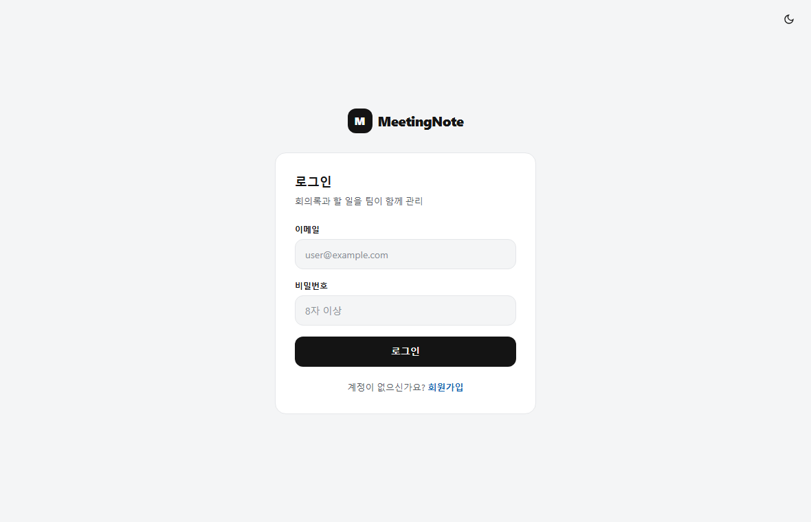

이메일과 비밀번호만으로 로그인합니다. 로그인에 실패하면 이메일이 없는지 비밀번호가 틀렸는지 구분하지 않고 같은 메시지(`INVALID_CREDENTIALS`)를 보여 계정 존재 여부가 드러나지 않습니다. 세션이 24시간을 넘겨 만료되면 어느 화면에서든 토큰을 지우고 이 화면으로 돌아오며 "세션 만료" 알림이 뜹니다.

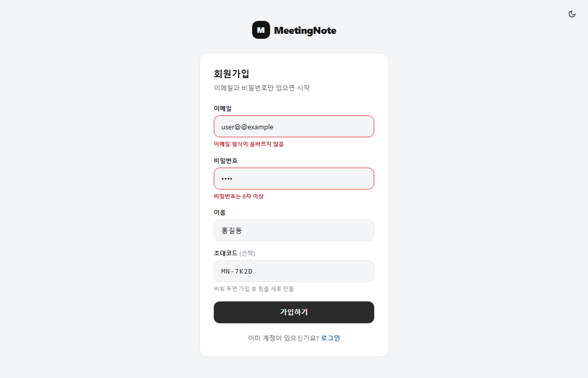

회원가입 모드에서는 이름과 **초대코드(선택)** 칸이 나타납니다. 이메일 형식과 8자 미만 비밀번호는 서버로 보내기 전에 화면에서 먼저 걸러 붉은 테두리와 한 줄 안내로 보여줍니다. 중복 이메일(409)과 같이 서버만 아는 오류는 상단 안내 상자로 나옵니다. 초대코드를 적으면 가입 직후 합류까지 이어서 처리하고, 코드가 틀리면 **가입은 유지한 채** 팀 설정 화면으로 보냅니다. 로그인 성공 후에는 소속 팀이 있으면 회의록, 없으면 팀 설정 화면으로 갑니다.

### 1-2. 팀 설정 — `team.html`

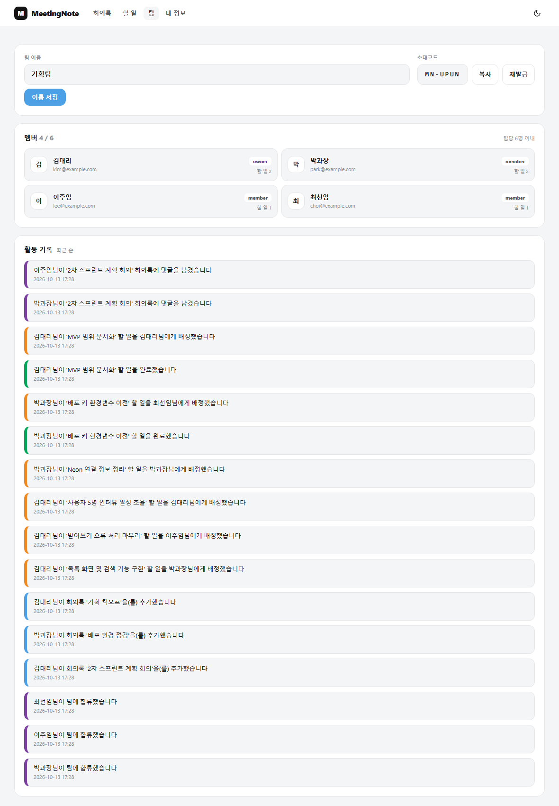

팀 이름, **초대코드**(복사 · 재발급), 멤버 목록(역할과 1인당 할 일 수), 팀 활동 기록을 한 화면에 모았습니다.

- 초대코드는 `MN-` 뒤에 영숫자 4자리입니다. 재발급하면 앞의 코드는 즉시 쓸 수 없게 되고 이미 합류한 멤버는 그대로입니다.
- 팀 이름 변경과 코드 재발급은 **owner 만** 할 수 있습니다. member 로 들어오면 이름 칸은 읽기 전용, 버튼은 비활성입니다.
- 팀당 최대 6명입니다. 가득 찬 팀에 합류하면 `TEAM_FULL` 안내가 나옵니다.
- 소속 팀이 없으면 이 화면이 "팀 만들기 / 초대코드로 합류" 두 칸으로 바뀝니다.
- 활동 기록은 종류별로 좌측 띠 색이 다릅니다(회의록 파랑 · 배정 주황 · 완료 초록 · 댓글/합류 보라).

### 1-3. 회의록 목록 — `meetings.html`

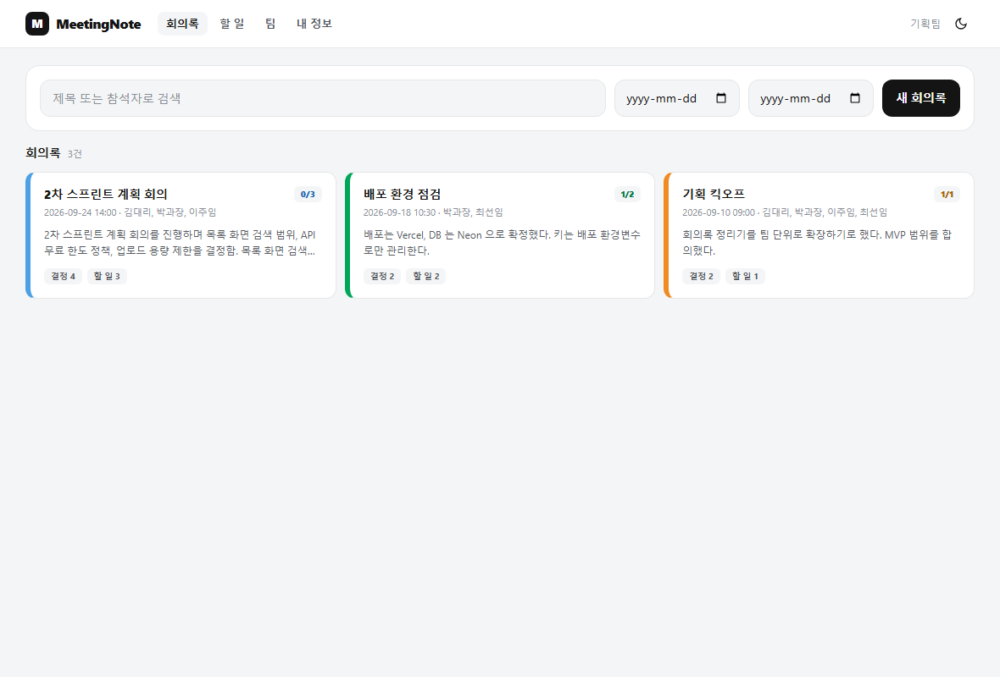

가장 오래 머무는 화면입니다. 제목 · 참석자 검색과 기간(from ~ to) 필터, 카드 목록, 새 회의록 버튼이 한 줄에 있습니다.

- 카드에는 제목, 회의 시각(현지 시간), 참석자, 요약 두 줄, `결정 N` · `할 일 N` 배지, 우측 상단에 **완료/전체 할 일**(`1/2`)이 보입니다. 목록 응답에는 본문(body)을 싣지 않습니다.
- 카드 좌측 띠 색은 목록 순서대로 파랑 · 초록 · 주황 · 보라 · 빨강을 돌려 씁니다.
- 검색은 **제목과 참석자만** 대상이고 본문은 검색하지 않습니다. 결과가 없으면 404 가 아니라 "검색 결과 없음" 빈 상태입니다.

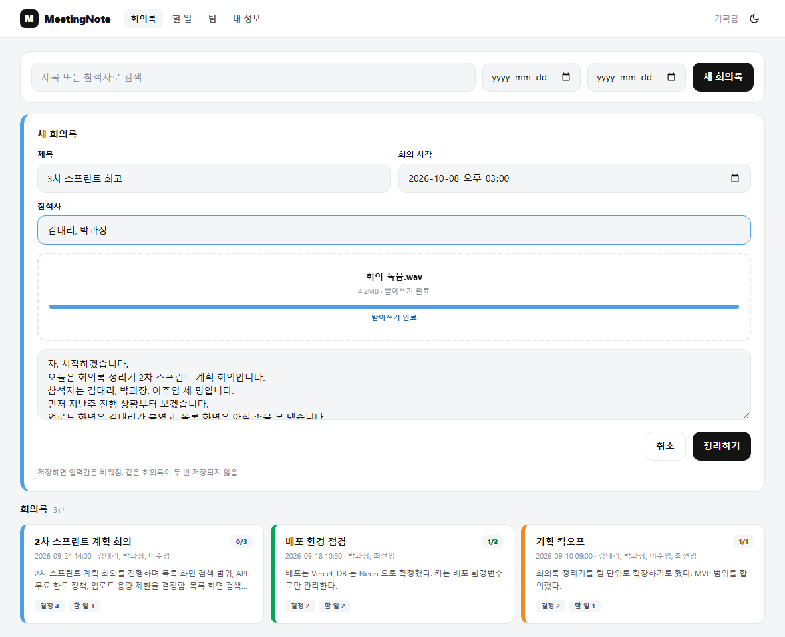

**새 회의록**을 누르면 입력 패널이 열립니다. 녹취 파일(mp3 · wav, 25MB 이하)을 끌어다 놓거나 눌러서 고르면 받아쓰기가 진행되고, 끝나면 본문 칸이 받아쓴 전문으로 채워집니다(위 캡처는 실제 Gemini 호출 결과). 형식 오류(415)와 용량 초과(413)는 올리기 전에 화면에서 안내하고, 제목 · 회의 시각 · 본문 중 빈 칸이 있으면 저장하지 않고 알려줍니다. 저장 중에는 버튼이 잠겨 같은 회의록이 두 번 저장되지 않습니다.

### 1-4. 회의록 상세 — `detail.html`

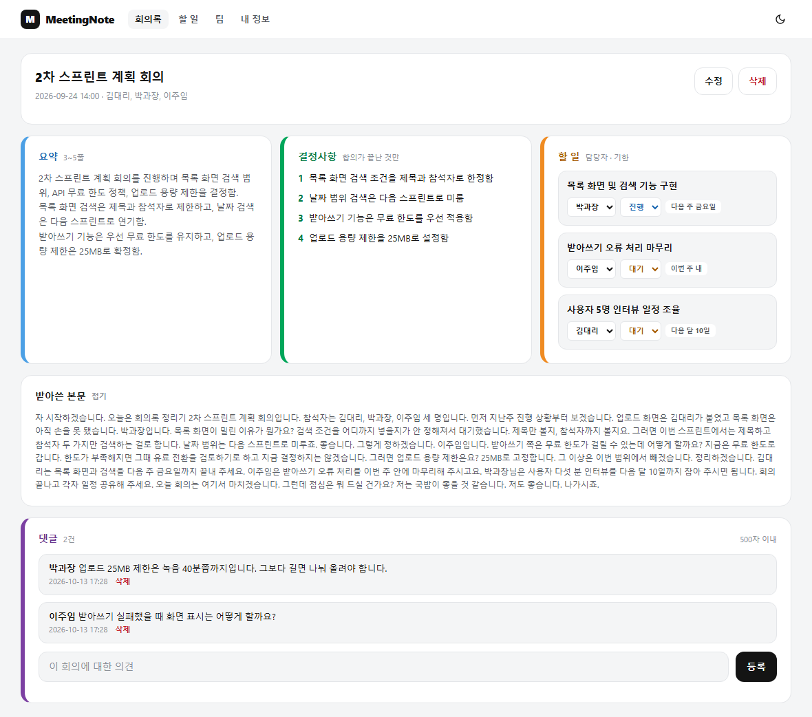

세 항목이 세 단으로 나란히 놓입니다.

- **요약**(파랑) · **결정사항**(초록, 합의가 끝난 것만 번호로) · **할 일**(주황, 담당자 · 상태 · 기한)
- 할 일 카드에서 담당자와 상태를 바로 고칩니다. 완료로 바꾸면 활동 기록에 남습니다.
- 결정사항이나 할 일이 비어 있으면 억지로 채우지 않고 "합의가 끝난 항목 없음" 같은 빈 상태를 보여줍니다.
- **받아쓴 본문**은 기본 접힘이라 세 항목을 먼저 읽게 됩니다. 단건 조회에만 본문이 실립니다.
- 수정 · 삭제는 **쓴 사람과 owner 에게만** 보입니다. 삭제하면 딸린 할 일과 댓글도 함께 지워지며 확인 상자가 먼저 뜹니다.
- 댓글(500자 이내)은 오래된 순이고, 삭제 버튼은 서버가 판정한 `can_delete`(작성자 본인 또는 owner)일 때만 나옵니다.

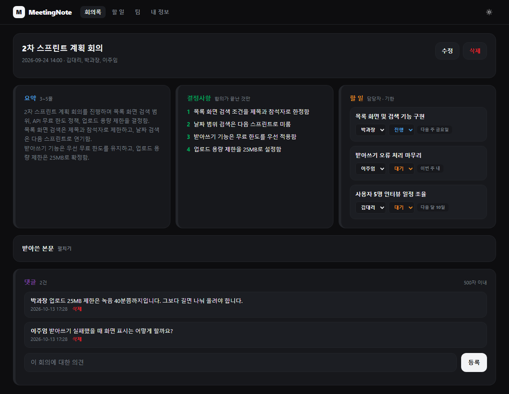

같은 구조에 배경만 뒤집은 다크 테마입니다. 카드 배경은 항상 무채색이고 색은 좌측 6px 띠와 라벨 글자에만 씁니다.

### 1-5. 할 일 칸반 — `todos.html`

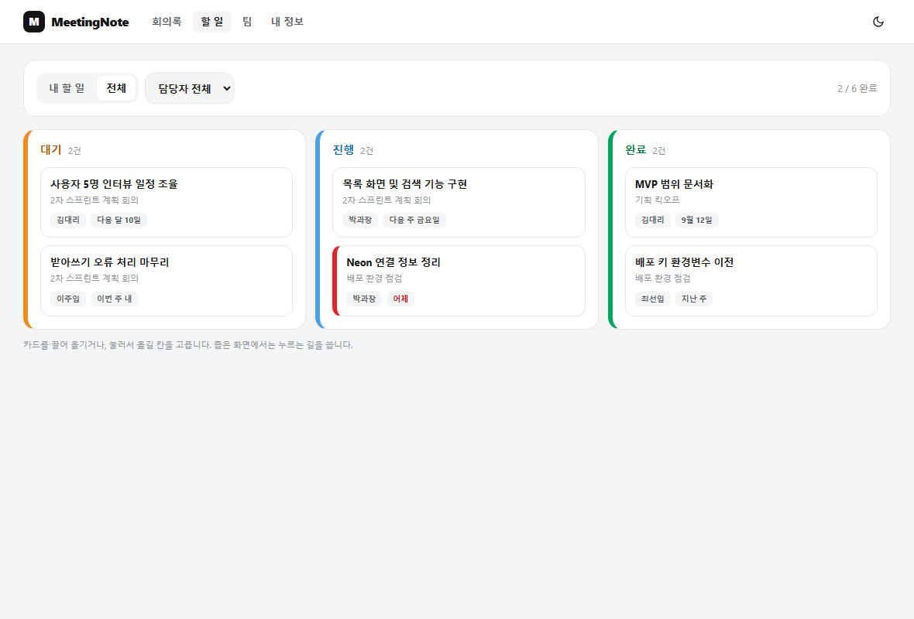

**대기 · 진행 · 완료** 3열입니다. `내 할 일` 탭은 나에게 배정된 카드만, `전체` 탭은 팀 전체를 보여주며 담당자 필터와 `n / m 완료` 요약이 있습니다.

- 카드를 **끌어서** 다른 칸에 놓으면 상태가 바뀝니다. HTML5 네이티브 드래그는 터치에서 동작하지 않아 **포인터 이벤트**로 구현했습니다. 놓는 순간 한 번만 서버를 부르고, 실패하면 카드가 원래 칸으로 돌아옵니다.
- 좁은 화면에서는 칸이 세로로 쌓여 끌 수 없으므로 카드를 **눌러** 옮길 칸을 고릅니다.
- 담당자 배지를 누르면 다음 멤버로 바뀌고(마지막 다음은 미정), owner 에게만 삭제 버튼이 보입니다.
- 기한이 지난 항목은 좌측 **빨간 띠**가 붙습니다(위 캡처의 `Neon 연결 정보 정리 · 어제`). 기한은 자유 글자(`due_text`)라 서버가 아니라 화면이 지난 날짜를 읽어 판정하며, 완료된 할 일은 제외합니다.

### 1-6. 내 정보 — `profile.html`

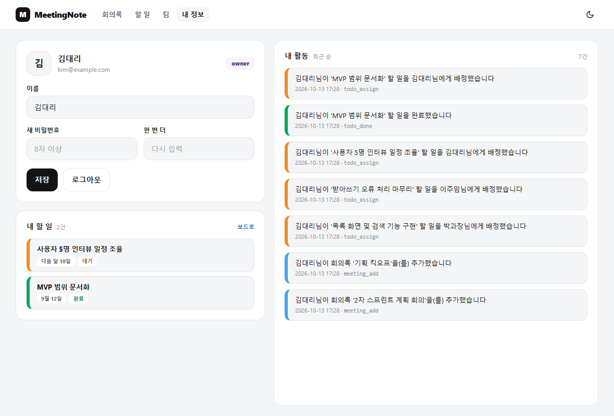

이름과 비밀번호를 바꾸고, **내 할 일**과 **내 활동**을 한 화면에서 봅니다. 새 비밀번호가 확인값과 다르거나 8자 미만이면 화면에서 먼저 거르고, 저장 중에는 버튼이 잠깁니다. 활동이 없으면 빈 상태를 보여줍니다. 로그아웃은 서버에 블랙리스트가 없으므로 화면이 토큰을 지우고 로그인 화면으로 보냅니다.

### 1-7. 모바일 (360px)

| 회의록 | 할 일 |
|---|---|
| 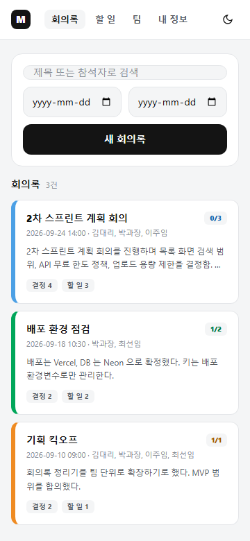 | 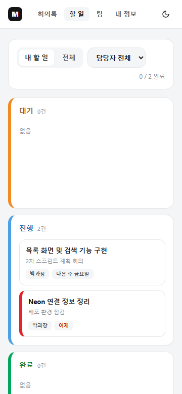 |

카드는 한 열로 접히고, 상단 메뉴는 로고만 남겨 네 항목이 한 줄에 들어갑니다. 가로 스크롤이 생기지 않고 글자가 잘리지 않는 것이 확인 기준입니다.

---

## 2. Swagger UI 로 API 직접 호출하기

서버를 띄우면 `http://127.0.0.1:8000/docs` 에서 API 26개를 화면 없이 시험할 수 있습니다. 태그는 `auth · team · meeting · todo · comment · activity` 6묶음입니다.

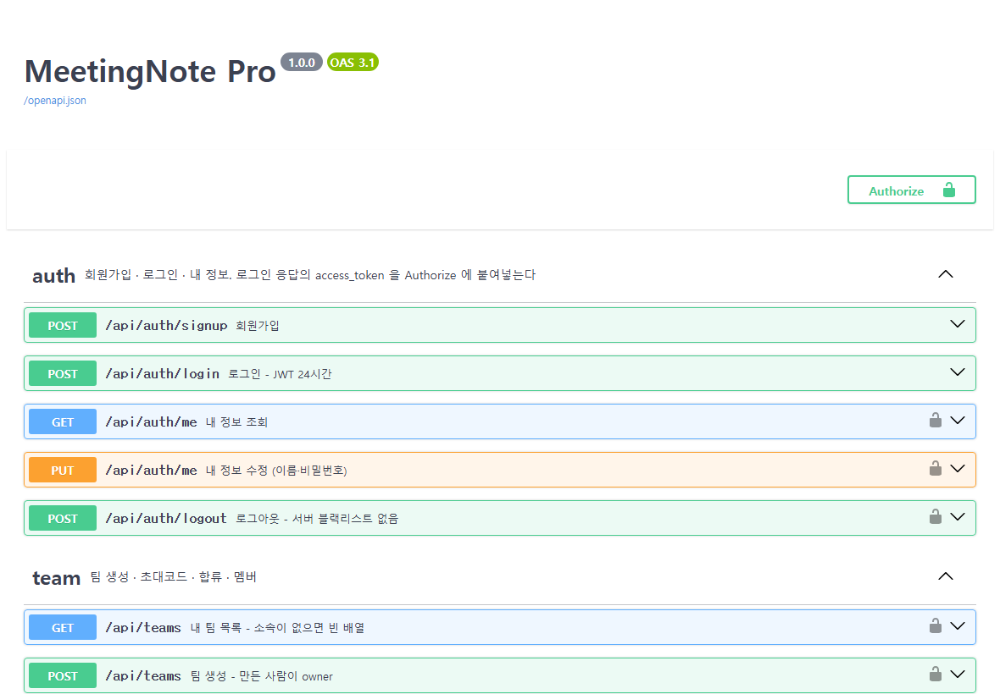

1. `POST /api/auth/signup` 또는 `POST /api/auth/login` 을 실행해 응답의 `access_token` 을 복사합니다.
2. 우측 상단 **Authorize** 에 토큰만 붙여넣습니다(Bearer 접두사는 자동).
3. 이후 인증이 필요한 API 를 **Try it out → Execute** 로 호출합니다.

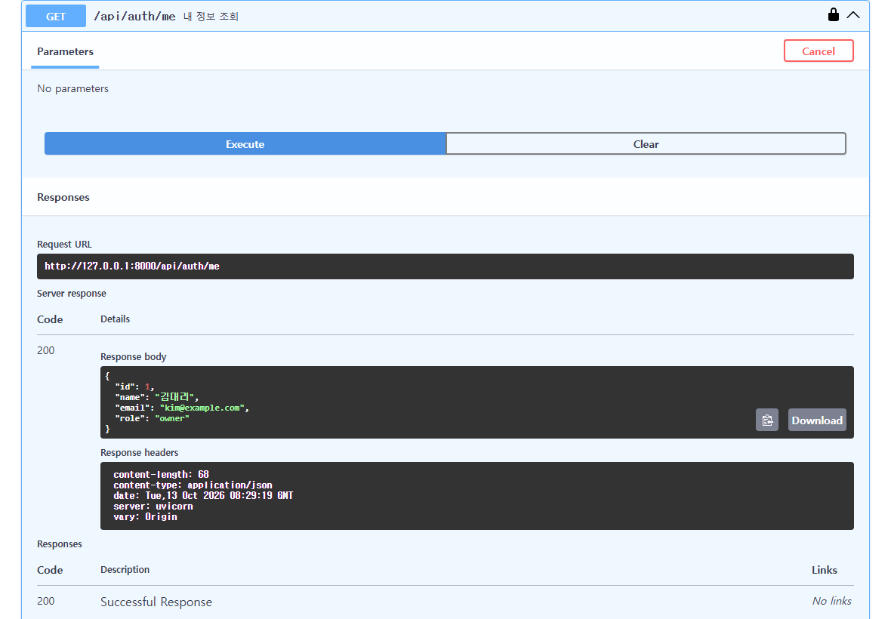

`POST /api/upload` 에서는 **Choose File** 로 녹취 파일을 올려 실제 받아쓰기 결과(전문 · 요약 · 결정사항 · 할 일)를 바로 볼 수 있습니다.

---

## 3. 이렇게 쓰입니다 (사용자 시나리오)

| # | 누가 | 흐름 |
|---|---|---|
| 1 | 팀 리더 | 회원가입 → 로그인 → 팀 생성 · 초대코드 발급 → 멤버 합류 → 녹취 업로드 → 3항목 구분 → 할 일 배정 |
| 2 | 팀원 | 로그인 → 칸반에서 담당 할 일을 완료로 이동 → 활동 기록에 기록 |
| 3 | 신규 합류자 | 초대코드로 진입 → 검색으로 지난 회의 찾기 → 결정사항을 읽고 댓글로 질문 |
| 4 | 팀 리더 | 내 정보에서 이름 · 비밀번호 변경 → 활동 기록으로 이번 주 팀 흐름 확인 |

---

## 4. API 26개

모든 경로는 `/api/` 접두사입니다. 오류는 항상 `{code, msg}` 한 가지 형식입니다.

| 묶음 | 메서드 · 경로 | 설명 |
|---|---|---|
| **auth** (5) | `POST /api/auth/signup` | 회원가입 → 201 + JWT |
| | `POST /api/auth/login` | 로그인 → JWT(24h) |
| | `GET /api/auth/me` | 내 정보(`id · name · email · role`) |
| | `PUT /api/auth/me` | 이름 · 비밀번호 변경 |
| | `POST /api/auth/logout` | 로그아웃(서버 블랙리스트 없음) |
| **team** (6) | `POST /api/teams` | 팀 생성(만든 사람이 owner) |
| | `GET /api/teams` | 내 팀 목록(없으면 빈 배열) |
| | `POST /api/teams/join` | 초대코드로 합류 |
| | `GET /api/teams/{id}/members` | 멤버 목록(+ 1인당 할 일 수) |
| | `PUT /api/teams/{id}` | 팀 이름 변경(owner) |
| | `PUT /api/teams/{id}/code` | 초대코드 재발급(owner) |
| **meeting** (6) | `POST /api/upload` | 녹취 업로드 → 받아쓰기 · 3항목 구분 |
| | `POST /api/teams/{id}/meetings` | 회의록 저장 |
| | `GET /api/teams/{id}/meetings` | 목록(`?q=` 제목·참석자, `?from=&to=` 기간) |
| | `GET /api/meetings/{id}` | 상세(본문 · 3항목 · 할 일) |
| | `PUT /api/meetings/{id}` | 수정(작성자 · owner) |
| | `DELETE /api/meetings/{id}` | 삭제(작성자 · owner, 할 일 · 댓글 연쇄 삭제) |
| **todo** (4) | `GET /api/teams/{id}/todos` | 팀 전체 할 일 |
| | `GET /api/me/todos` | 내게 배정된 할 일 |
| | `PUT /api/todos/{id}` | 상태 변경 · 담당자 배정 |
| | `DELETE /api/todos/{id}` | 삭제(owner) |
| **comment** (3) | `POST /api/meetings/{id}/comments` | 댓글 달기(500자 이하) |
| | `GET /api/meetings/{id}/comments` | 목록(`can_delete` 포함) |
| | `DELETE /api/comments/{id}` | 삭제(작성자 · owner) |
| **activity** (2) | `GET /api/teams/{id}/activities` | 팀 활동(최신순 최근 50건) |
| | `GET /api/me/activities` | 내 활동 |

### 오류 코드

`EMAIL_INVALID` · `EMAIL_DUPLICATED` · `PASSWORD_TOO_WEAK` · `INVALID_CREDENTIALS` · `TOKEN_EXPIRED` · `INVITE_NOT_FOUND` · `TEAM_FULL` · `MEETING_NOT_FOUND` · `PAYLOAD_TOO_LARGE`(413) · `UNSUPPORTED_MEDIA_TYPE`(415) · `FORBIDDEN` · `OWNER_ONLY` · `VALIDATION_ERROR` · `NOT_FOUND`. 외부 받아쓰기 호출이 실패한 경우만 500 `INTERNAL_ERROR` 를 씁니다.

### 권한

| 동작 | member | owner |
|---|---|---|
| 팀 자원(멤버 · 회의록 · 할 일 · 활동) 조회 | 자기 팀만 | 자기 팀만 |
| 회의록 수정 · 삭제, 댓글 삭제 | 쓴 사람만 | 모두 |
| 팀 이름 변경, 초대코드 재발급, 할 일 삭제 | 불가(`OWNER_ONLY`) | 가능 |

활동 기록의 `kind` 는 `meeting_add` · `todo_assign` · `todo_done` · `comment_add` · `member_join` 다섯 가지뿐이며, 문장은 서버가 만들어 화면은 그대로 그립니다.

---

## 5. 디자인 시스템

`frontend/theme.js` 한 곳에서만 정의하고 화면은 이름만 가져다 씁니다(`window.UI` · `STRIPE` · `LABEL` · `notice`).

| 규칙 | 값 |
|---|---|
| 팔레트 | blue · green · orange · red · purple, 색마다 dot(띠·점)과 text(흰 배경 위 글자) 두 값 |
| 카드 배경 | 언제나 무채색. 색은 **좌측 6px 띠와 라벨 글자**에만 |
| 버튼 높이 | 44px 하나(`h-11`) |
| 모서리 | 카드 `rounded-xl` · 패널 `rounded-2xl` 둘뿐 |
| 금지 | `!important`, 인라인 style, 새 색, 새 모서리 값, 클래스 임의 조합 |

이 규칙은 테스트가 지킵니다(`backend/tests/test_frontend.py`): 구현 화면에 쓰인 클래스가 `publish/` 에 없는 것이면 실패합니다. 예외는 확정 디자인에 있던 업로드 진행바의 `style="width:0%"` 하나입니다.

---

## 6. 실행하기

### 준비

```powershell
cd backend
python -m venv .venv
.venv\Scripts\python -m pip install -r requirements.txt
```

프로젝트 루트(`D:\meetingnote-pro`)에 `.env` 를 둡니다. `.env` 와 `*.db` 는 `.gitignore` 로 제외되어 저장소에 올라가지 않습니다.

| 키 | 필수 | 설명 |
|---|---|---|
| `GEMINI_API_KEY` | 받아쓰기에 필요 | Gemini API 키 |
| `GEMINI_MODEL` | 받아쓰기에 필요 | 사용할 모델 이름 |
| `JWT_SECRET` | 선택 | 없으면 처음 한 번 무작위로 만들어 `backend/.jwt_secret` 에 보관 |
| `DATABASE_URL` | 선택 | 있으면 Postgres(Neon), 없으면 로컬 SQLite(`meetingnote.db`) |
| `BCRYPT_ROUNDS` | 선택 | 기본 11 (로그인 250ms 이내 기준으로 정한 값) |
| `ENABLE_DOCS` | 선택 | `0` 이면 `/docs` 를 끔 |

### 실행

```powershell
cd backend
.venv\Scripts\python -m uvicorn app.main:app --reload
```

| 주소 | 내용 |
|---|---|
| http://127.0.0.1:8000/ | 화면(로그인 상태에 따라 로그인 또는 회의록으로 이동) |
| http://127.0.0.1:8000/docs | Swagger UI |

### 테스트

```powershell
cd backend
.venv\Scripts\python -m pytest
```

현재 **90개 통과**입니다.

| 파일 | 다루는 것 |
|---|---|
| `test_core` · `test_auth` | 7테이블, 오류 형식, 토큰 발급·만료·위조, 가입·로그인·내 정보, 로그인 평균 250ms 이내 |
| `test_team` | 생성 · 합류 · 정원 · owner 전용 · 다른 팀 접근 차단 |
| `test_meeting` | 업로드 제한(413 · 415), 저장 · 목록 · 검색 · 기간 · 상세 · 수정 · 삭제 · 연쇄 삭제 |
| `test_todo` | 목록 · 정렬 · 상태 변경 · 담당자 배정 · owner 삭제 |
| `test_comment_activity` | 댓글 500자, `can_delete`, 활동 50건 제한, kind 5종 |
| `test_openapi` | API 26개 · 6묶음 태그 · Bearer Authorize |
| `test_frontend` | 화면 ↔ API 매핑표 비교, 디자인 규칙(새 클래스 · `!important` · 새 색 금지) |

받아쓰기(Gemini)는 pytest 에서 고정 응답으로 바꿔 끼워 실제 호출을 하지 않습니다. 실제 호출은 Swagger 의 `POST /api/upload` 나 화면의 업로드로 확인합니다. 개발 중에는 Playwright 로 실제 브라우저를 띄워 화면 상태 약 45개와 Swagger UI 29개 항목도 확인했습니다.

---

## 7. 배포 (Vercel + Neon)

**https://meetingnote-pro-blush.vercel.app** — 화면은 `/`, Swagger UI 는 `/docs` 입니다. 로컬과 같은 코드 한 벌이고, `DATABASE_URL` 이 있으면 Neon Postgres 로 연결됩니다.

| 구성 | 내용 |
|---|---|
| 함수 | `api/index.py` 가 `backend/app` 의 FastAPI 앱을 노출하고, `vercel.json` 의 rewrite 가 모든 경로(화면 · API)를 이 함수로 보냅니다. 화면(`frontend/`)도 같은 함수가 정적으로 내보냅니다 |
| 제한 시간 | 함수 최대 60초 (받아쓰기 2단계가 한 요청 안에서 끝나야 함) |
| DB | Vercel Storage 의 Neon Postgres. 풀러 주소(`DATABASE_URL`)를 쓰고, 서버리스라 연결 풀은 끕니다(`NullPool`) |
| 환경변수 | Neon 연동이 `DATABASE_URL` 등을 자동 등록하고, `JWT_SECRET` · `GEMINI_API_KEY` · `GEMINI_MODEL` 은 Sensitive 로 직접 등록했습니다 |
| 제외 파일 | `.vercelignore` 가 테스트 · 문서 · `.venv` · `.env*` 를 배포에서 뺍니다 |

**마이그레이션** — Postgres 에서는 앱이 시작할 때 테이블을 만들지 않고 `backend/migrate.py` 로 만듭니다(직접 연결 주소 `DATABASE_URL_UNPOOLED` 사용, 반복 실행해도 안전).

```powershell
vercel env pull .env.local          # Neon 접속 정보를 .env.local 로 (gitignore 됨)
cd backend
.venv\Scripts\python migrate.py            # 없는 테이블만 만든다
.venv\Scripts\python migrate.py --reset    # 모두 지우고 다시 만든다 (데이터가 사라짐)
```

**다시 배포하려면** 프로젝트 루트에서 `vercel deploy --prod` 를 실행합니다.

> **업로드 용량:** Vercel 함수는 요청 본문이 약 4.5MB 로 제한되어, 배포 환경에서는 스펙의 25MB 가 아니라 **약 4.5MB 이하**의 녹취만 받아쓸 수 있습니다(데모 녹음 4.4MB 는 통과). 한도를 넘으면 플랫폼이 413 을 돌려주고 화면은 용량 초과로 안내합니다. 25MB 를 받으려면 파일을 스토리지에 직접 올리는 구조가 필요하며 이번 범위 밖입니다.

---

## 8. 폴더 구조

```
api/index.py           Vercel 진입점
vercel.json · .vercelignore · requirements.txt   배포 설정 (requirements.txt 는 배포용, 개발용은 backend/requirements.txt)
backend/
  migrate.py           Neon 스키마 마이그레이션
  app/
    main.py            앱 진입점 · Swagger · 정적 화면 제공
    config.py · db.py · models.py   설정 · DB 분기 · 7테이블
    errors.py · security.py · deps.py   오류 형식 · bcrypt/JWT · 인증 의존성
    transcriber.py     Gemini 받아쓰기 2단계 (테스트에서 바꿔 끼우는 지점)
    routers/           auth · team · meeting · todo · comment · activity
  tests/               pytest 90개
frontend/              화면 6종 + theme.js(디자인 규칙) + api.js(공통 fetch)
publish/               확정된 퍼블리싱 원본 (수정하지 않음)
docs/                  프로그램 정의서 · 스토리보드 · 디자인 시스템(PDF), screenshots/
openspec/
  specs/               주 스펙 6개 (auth · team · meeting · todo · comment · activity)
  changes/archive/     2026-10-13-add-mvp-core (제안 · 설계 · tasks · 스펙 델타)
```

---

## 9. 스펙과 결정 기록

이 프로젝트는 OpenSpec 으로 진행했습니다. 정의서 · 스토리보드 · 디자인 시스템을 `proposal → specs → design → tasks` 로 풀고(`add-mvp-core`, 28개 작업 모두 완료) 아카이브하여 주 스펙 6개로 남겼습니다. 각 요구사항 첫 줄의 주석에 근거 스토리보드 ID 와 퍼블리싱 파일이 적혀 있습니다.

구현 중에 정하거나 바꾼 것:

- **팀 id 출처:** `GET /api/auth/me` 에는 팀 id 가 없어서, 로그인 직후 `login.html` 이 `GET /api/teams` 로 소속 팀을 확인해 `localStorage` 에 저장하고 다른 화면은 저장값을 씁니다. 사용자 id 는 JWT 의 `sub` 에서 읽습니다.
- **bcrypt 비용 11:** 이 PC 에서 12 는 bcrypt 만 평균 224ms(최대 271ms)라 "로그인 250ms 이내" 기준을 넘나들어 11(평균 106ms)로 정했습니다.
- **한 사용자는 팀 하나:** 스토리보드의 "소속 팀 없음" 화면과 로그인 후 단일 분기에 맞췄습니다. 이미 팀이 있으면 만들기 · 합류가 거절됩니다.
- **회의록 수정 권한:** 문서에 명시가 없어 삭제와 같은 규칙(작성자 + owner)으로 두었습니다.
- **화면 ↔ API 매핑표(스토리보드 73쪽)와 다른 곳 4개**(고유 경로 26개와 쓰이지 않는 경로 0개는 그대로):
  - `login.html` 에 `GET /api/teams` 추가(위의 팀 id 결정)
  - `detail.html` · `todos.html` 에 `GET /api/teams/{id}/members` 추가(담당자 선택 목록에 필요한데 표에서 빠져 있음)
  - 로그아웃은 표에 `meetings.html` 로 적혀 있지만 확정 디자인의 버튼은 `profile.html` 에 있어 `profile.html` 에 둠

### 범위 외 (만들지 않기로 한 것)

실시간 녹음 · 화자 자동 구분 · 외부 연동(캘린더 · 메일) · owner/member 외 권한 등급 · 분할 업로드(25MB 초과) · 푸시 알림.

### 알려진 한계

- **기한 수정:** 할 일의 `due_text` 는 회의록 저장 때 정해지고, 이후 화면에서 고치는 API 는 없습니다(스펙에 없음).
- 할 일 칸반의 담당자 배지는 눌러서 다음 멤버로 돌리는 방식입니다(확정 디자인의 조작 방식).
